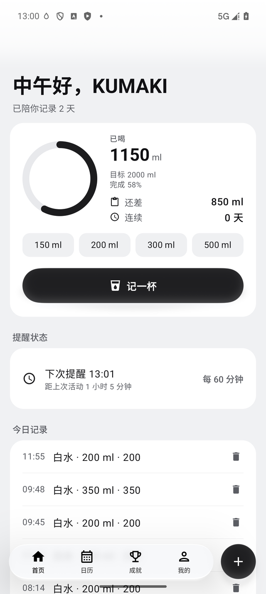
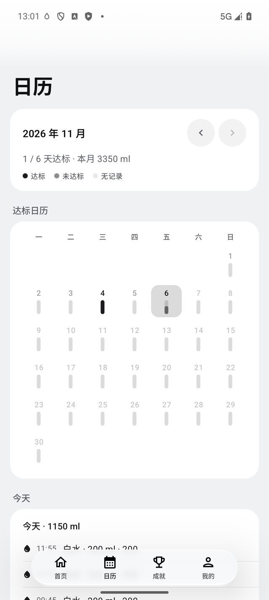
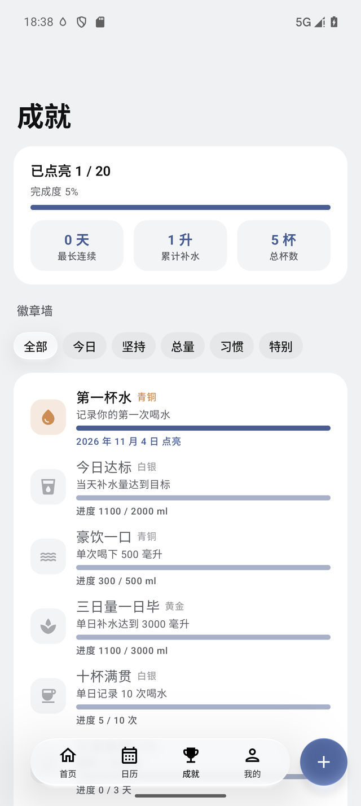
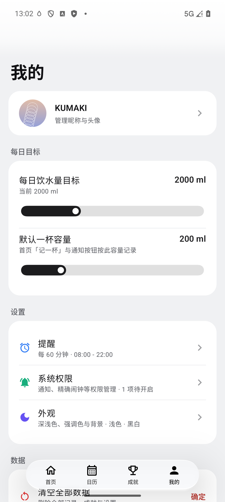
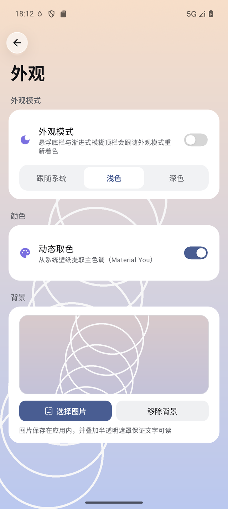

# DailyDrink · 水杯

一款轻量、无广告、数据完全本地的喝水提醒 App。界面基于 ColorOS 17 的 COUI-Kit 风格设计，支持定时提醒、实时活动、达标日历与成就系统。

[](https://developer.android.com)
[](https://kotlinlang.org)
[](https://developer.android.com/jetpack/compose)
[](https://github.com/1660757572/DailyDrink/releases/latest)
[](LICENSE)

## 界面预览

| 首页 | 日历 |
| :---: | :---: |
|  |  |
| **成就** | **我的** |
|  |  |

> 界面预览为默认外观（浅色 · 未设置自定义背景）；外观设置可切换深/浅色、强调色模板与自定义取色、背景图片、遮罩不透明度 / 高斯模糊 / 容器不透明度



## 功能

### 记录饮水
- 首页「记一杯」按默认容量一键记录，快捷按钮支持 150 / 200 / 300 / 500 ml
- 「记一杯」弹窗可选择容量、饮品类型与记录时间，忘记记录时可补记（时间选择器只允许选今天已过去的时刻）
- 内置白水、淡茶、牛奶、汤品、咖啡、饮料等类型，可按补水系数折算有效补水，并支持自定义饮品
- 今日记录可单条删除，首页圆环展示已喝、还差、连续天数，达标时圆环收口并打勾

### 目标与日历
- 每日饮水量目标、默认一杯容量可随时调整
- 达标日历按月查看每日达标情况，今日时间线按时间倒序展示当天记录

### 提醒与实时活动
- 定时提醒：可设置提醒间隔、开始/结束时间、提示音与震动
- 提醒通知提供「确认 X ml」「稍后 10 分钟」两个按钮，直接完成记录或推迟
- 常驻实时活动展示今日进度、倒计时与两键操作，ColorOS 上以流体云胶囊/卡片呈现
- 开机自动恢复提醒计划，权限缺失时在「我的 → 系统权限」中引导开启

### 成就系统
- 36 枚成就徽章，分为今日 / 坚持 / 总量 / 习惯 / 特别等分类，使用 COUI ChipTab 横向切换，前置筛选菜单可直接跳到全部或已获得
- 展示点亮进度、累计补水、最长连续与总杯数
- 徽章详情二级页由共享元素动画衔接，支持左右滑动连续查看

### 个性化
- 深色 / 浅色 / 跟随系统，深色为纯黑、浅色为 #F0F1F3 纯色底
- 强调色提供水蓝、动态取色、草野、柠檬、黑白五套模板，也可用取色器自定义主色调
- 支持选择本地图片作为页面背景（图片保存在应用私有目录），遮罩不透明度、高斯模糊与容器不透明度均可调节，一键恢复默认
- 头像从系统相册选择后可拖动、缩放裁剪，昵称与头像显示在「我的」页面
- 首启引导：欢迎、个人信息、每日目标、提醒、权限五步完成初始化
- 「我的 → 关于」展示版本、组件来源与许可信息

## 技术栈

| 项目 | 说明 |
| --- | --- |
| 语言 | Kotlin 2.4 |
| UI | Jetpack Compose（BOM 2026.08.01）+ Material 3 |
| 设计体系 | COUI-Kit 0.0.1-alpha7（ColorOS 17 液态玻璃组件，`io.github.itoseo:coui`） |
| 存储 | DataStore Preferences（全部数据仅存本机） |
| 提醒 | AlarmManager + WorkManager + 通知渠道 |
| SDK | minSdk 31 · targetSdk 37 · compileSdk 37 |

## 权限说明

| 权限 | 用途 |
| --- | --- |
| `POST_NOTIFICATIONS` | 发送喝水提醒与实时活动通知 |
| `POST_PROMOTED_NOTIFICATIONS` | 实时活动提升为常驻通知，供系统流体云展示 |
| `SCHEDULE_EXACT_ALARM` | 按设定时间准点提醒 |
| `VIBRATE` | 提醒时震动 |
| `WAKE_LOCK` | 后台准时触发提醒 |
| `RECEIVE_BOOT_COMPLETED` | 重启后恢复提醒计划 |

所有饮水记录与设置仅保存在本机 DataStore 中，App 不联网、不上传任何数据。

## 项目结构

```
app/src/main/java/com/aquaday/app/
├── data/        # DataStore、指标计算、成就定义
├── reminder/    # 通知渠道、Alarm/Work 调度、实时活动、开机恢复
└── ui/          # 页面、主题与组件（首页/日历/成就/我的/引导/设置）
```

## 下载

前往 [Releases](https://github.com/1660757572/DailyDrink/releases/latest) 下载最新 APK。

## 许可证

[MIT](LICENSE) © 2026 KUMAKI
